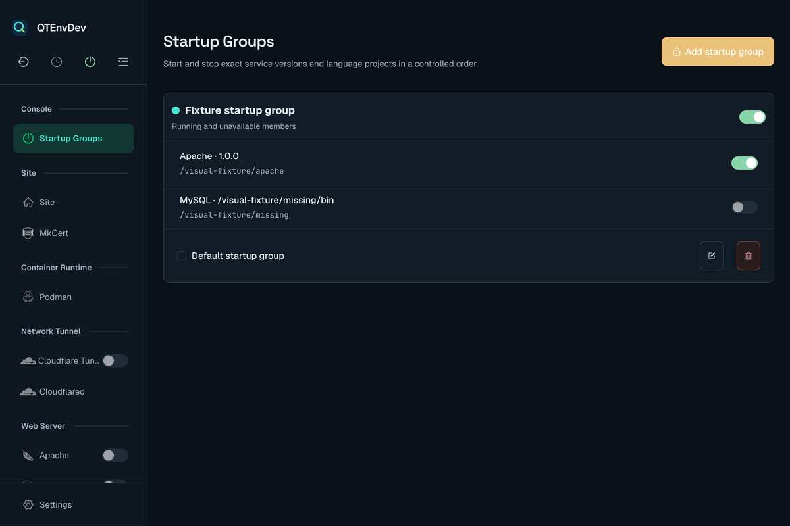
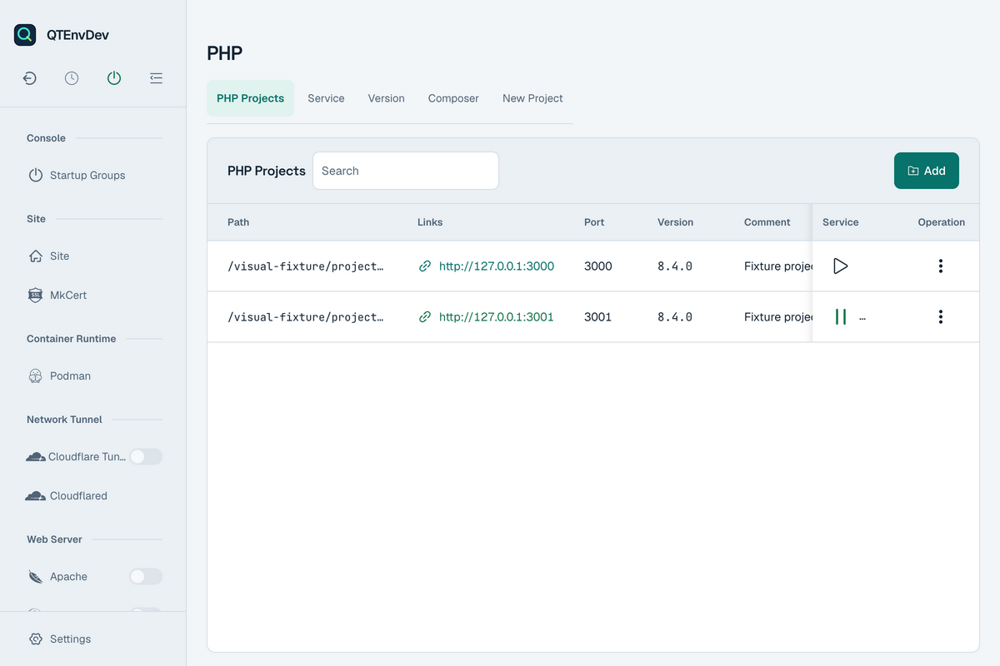
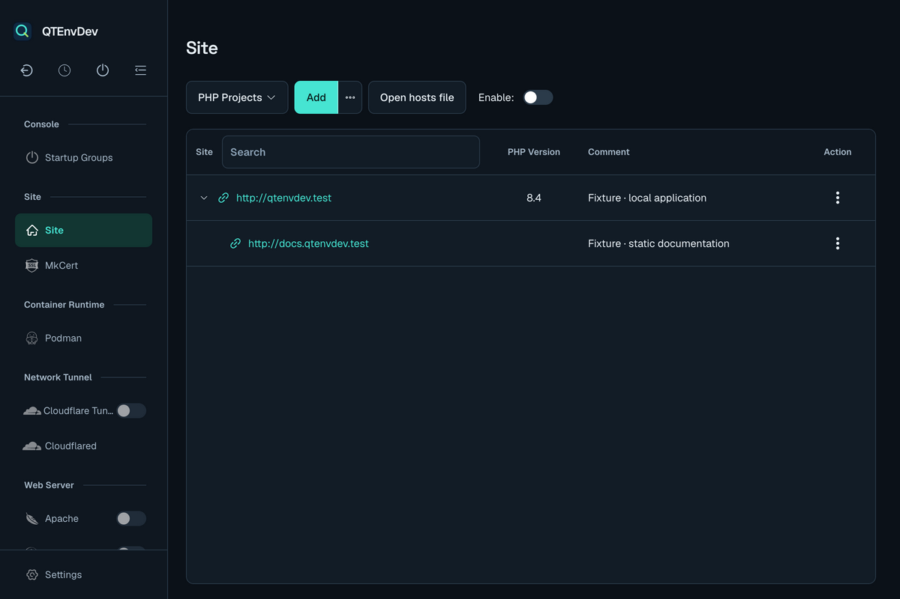
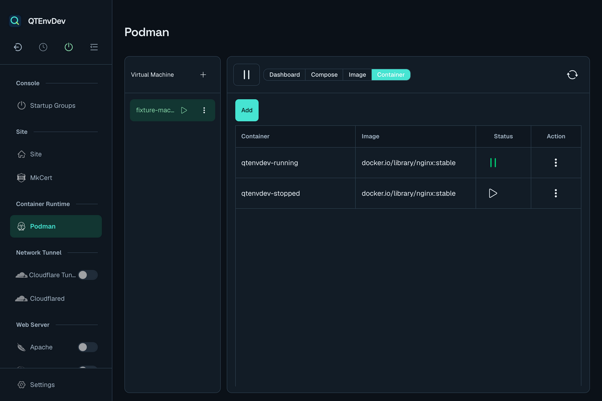
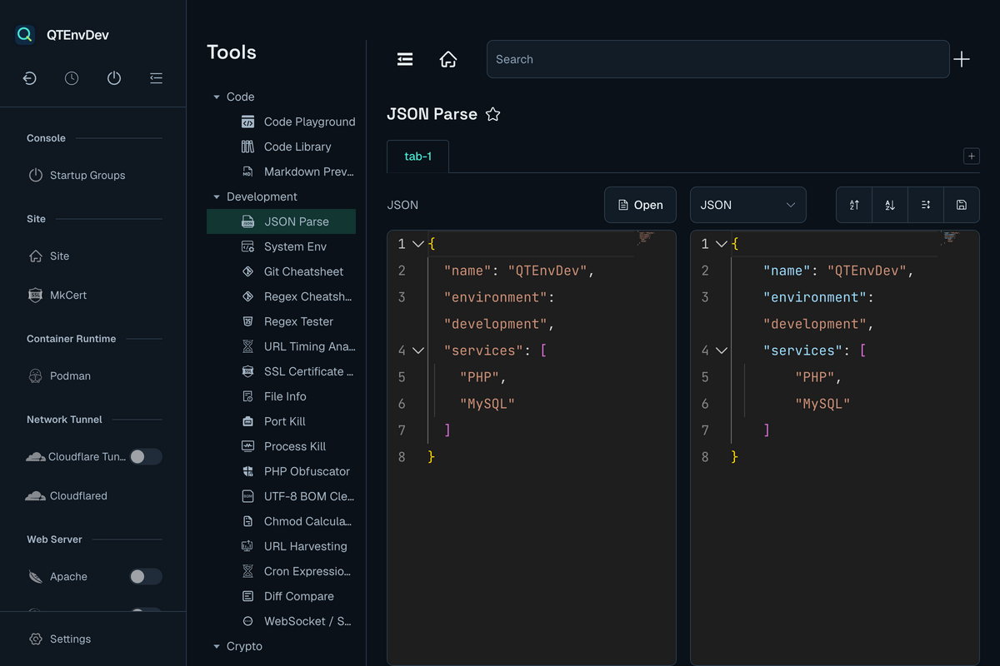
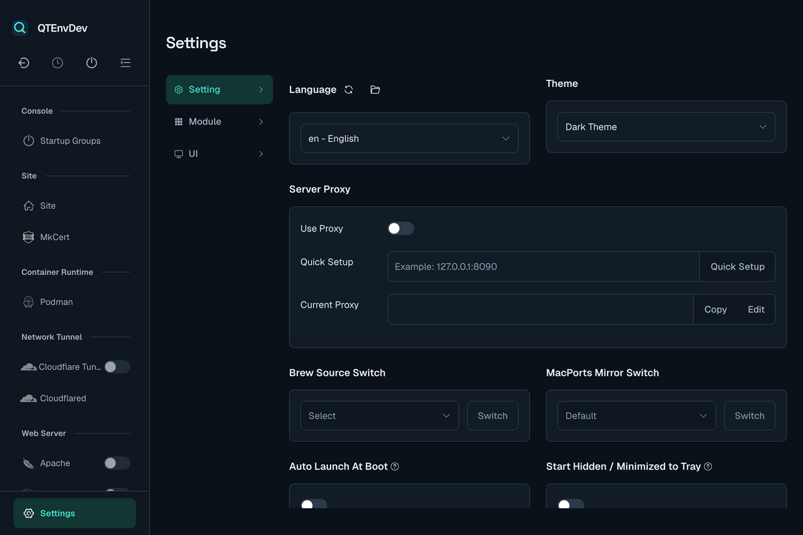

<!-- Hallmark · pre-emit critique: P4 H4 E3 S5 R4 V4 · scope: six pilot workspaces; technical acceptance incomplete -->

# QTEnvDev — Duyệt 6 mẫu giao diện

Ngày: 17/11/2026 · QTEnvDev 4.21.0 · **sẵn sàng duyệt hướng thiết kế, chưa nghiệm thu kỹ thuật toàn bộ**.

Đã triển khai foundation và sáu workspace đại diện bằng component Vue thực. Hướng nhìn là **modern-minimal technical workbench**: nền graphite/navy, điểm nhấn teal, bảng phẳng, action dễ tìm, editor rộng và light mode tương ứng. Nguồn chuẩn là [design.md](../design.md); [plan](ui-redesign-plan.md) và [inventory](ui-redesign-inventory.md) quản lý phạm vi **103 màn hình chính**.

Đây là mốc đánh giá mẫu trước rollout. Sáu workspace mẫu bao gồm trang Tools và công cụ JSON bên trong; không quy đổi thành sáu ID độc lập để tính phần trăm hoàn thành. Các trang ngoài mẫu có thể nhận token dùng chung nhưng chưa được xem là đã refactor hoặc nghiệm thu.

## 1. Những gì đã thay đổi

| Mẫu / ID | Phần đã triển khai để duyệt | Phần cần hoàn thiện ở batch sâu |
| --- | --- | --- |
| Startup groups · R53 | Shell; header; nhóm phẳng; hàng thành viên; form ba bước, validation tên, chọn bằng bàn phím, đổi thứ tự, footer trong viewport; Add/Edit/Save fixture, hủy draft đã sửa; lỗi tải candidate và lỗi lưu Add/Edit có retry giữ draft | Kéo thả, toàn bộ Tab order, mọi loại lỗi/progress/partial, thao tác nhóm thật |
| PHP · R39 | Header/tab; bảng dự án với path mono; action chính/phụ; style drawer config/extensions | Luồng create/edit dự án, mọi nguồn version/extension và mọi trạng thái cài đặt |
| Hosts · R23 | Header/toolbar; bảng site và tìm kiếm; menu action; drawer chỉnh site có nhãn và nhóm trường | Tomcat, advanced/SSL ở mọi tổ hợp, vhost/template, import/export/ghi hosts thật |
| Podman · R42 | Machine/resource workspace; nút start/stop/menu; danh sách container; form tạo machine/container | Dashboard/detail/image/compose đầy đủ, các luồng resource thật và terminal |
| Tools/JSON · R58 + T18 | Danh mục công cụ phẳng; search/filter; input/output JSON; action có nhãn; xếp dọc ở cửa sổ hẹp | 37 công cụ khác, Tools qua drawer/custom host, mọi chế độ editor và lỗi nghiệp vụ |
| Settings · R62 | Điều hướng Common/Modules/UI bằng nút; layout detail; form và theme sáng/tối; sửa vòng đời editor và kiểm tra chuyển trang | Tất cả trường/overlay và tùy chọn nền tảng |

Foundation gồm token semantic light/dark, bridge Element Plus/Tailwind, font cục bộ Space Grotesk/Geist/JetBrains Mono, nhịp control 44px, sidebar 224/56px và focus ring tức thì. Tùy chọn font/theme hiện có tiếp tục được sử dụng. Không thêm state nghiệp vụ hoặc operation IPC mới.

## 2. Bộ ảnh duyệt

Ảnh 1200×800, dữ liệu có chữ **Fixture** hoặc đường dẫn `/visual-fixture`. Các đường dẫn, phiên bản và trạng thái trong ảnh chỉ phục vụ kiểm tra hiển thị.

| Workspace | Dark | Light |
| --- | --- | --- |
| Startup groups | [Xem ảnh](ui-redesign/pilots/startup-groups-dark.png) | [Xem ảnh](ui-redesign/pilots/startup-groups-light.png) |
| PHP projects | [Xem ảnh](ui-redesign/pilots/php-projects-dark.png) | [Xem ảnh](ui-redesign/pilots/php-projects-light.png) |
| Hosts có dữ liệu | [Xem ảnh](ui-redesign/pilots/hosts-dark.png) | [Xem ảnh](ui-redesign/pilots/hosts-light.png) |
| Podman containers | [Xem ảnh](ui-redesign/pilots/podman-containers-dark.png) | [Xem ảnh](ui-redesign/pilots/podman-containers-light.png) |
| JSON input/output | [Xem ảnh](ui-redesign/pilots/json-dark.png) | [Xem ảnh](ui-redesign/pilots/json-light.png) |
| Settings | [Xem ảnh](ui-redesign/pilots/settings-dark.png) | [Xem ảnh](ui-redesign/pilots/settings-light.png) |
| Thư viện Tools | [Xem ảnh](ui-redesign/pilots/tools-library-dark.png) | [Xem ảnh](ui-redesign/pilots/tools-library-light.png) |

Các ảnh bổ sung trong bộ 58 ảnh:

- Overlay ở 800×600: [Hosts edit](ui-redesign/pilots/host-edit-dark-800.png), [PHP config](ui-redesign/pilots/php-config-dark-800.png), [PHP extensions](ui-redesign/pilots/php-extensions-dark-800.png), [Podman machine](ui-redesign/pilots/podman-machine-dark-800.png), [Podman container](ui-redesign/pilots/podman-container-dark-800.png).
- Cửa sổ hẹp: [PHP 800px](ui-redesign/pilots/php-projects-light-800.png), [Hosts 375px](ui-redesign/pilots/hosts-light-375.png), [Settings 375px](ui-redesign/pilots/settings-dark-375.png), [Tools 320px](ui-redesign/pilots/tools-library-dark-320.png), [JSON đầu vào lỗi 800px](ui-redesign/pilots/json-invalid-dark-800.png). Với editor xếp dọc, kết quả ở vùng cuộn phía dưới; một ảnh không chứng minh toàn bộ luồng báo lỗi.
- Desktop bổ sung: [JSON 1024px sau sửa toolbar](ui-redesign/pilots/json-dark-1024.png), [JSON 1440px](ui-redesign/pilots/json-light-1440.png). Toolbar kết quả được xuống hàng khi hai thanh bên làm giảm vùng nội dung.
- Đúng kích thước desktop: [Hosts dark 1024×768](ui-redesign/pilots/hosts-dark-1024x768.png), [Settings UI light 1440×900](ui-redesign/pilots/settings-ui-light-1440x900.png), [Podman container dark 1024×768](ui-redesign/pilots/podman-container-dark-1024x768.png), [PHP config dark 1024×768](ui-redesign/pilots/php-config-dark-1024x768.png). Đã xem thêm ảnh Hosts edit light 1440×900 trong lần chạy; ảnh đó ở thư mục audit tạm, không cộng vào gallery cố định.
- Luồng bàn phím PHP: [trước sửa — Enter chỉ hiện tooltip](ui-redesign/pilots/php-config-keyboard-before-dark-1200.png), [sau sửa — config mở ở 1200×800 dark](ui-redesign/pilots/php-config-nested-dark-1200x800-opened.png), [focus trở về Extensions ở 800×600 light](ui-redesign/pilots/php-config-nested-light-800x600-restored.png). Lưu đủ tám ảnh mở/đóng sau sửa theo hai theme và hai kích thước; đã xem trực tiếp bốn ảnh đại diện cùng ảnh trước sửa.
- Search PHP Extensions: [trước sửa 800×600 light](ui-redesign/pilots/php-extensions-search-before-light-800x600.png), [sau sửa 800×600 light](ui-redesign/pilots/php-extensions-search-final-light-800x600.png), [sau sửa 1200×800 dark](ui-redesign/pilots/php-extensions-search-final-dark-1200x800.png). Hai ảnh cuối đã được xem trực tiếp; các ảnh nested PHP trước đó giữ làm lịch sử trước sửa chiều cao Search.
- Form StartupGroup: [Enter Edit trước sửa](ui-redesign/pilots/startup-editor-keyboard-before-light-800x600.png); [thông tin cơ bản VI light 1200×800](ui-redesign/pilots/startup-editor-vi-light-1200x800-basic.png); [chọn dịch vụ VI light 800×600](ui-redesign/pilots/startup-editor-vi-light-800x600-candidates.png); [thứ tự VI light 1200×800](ui-redesign/pilots/startup-editor-vi-light-1200x800-order.png); [thứ tự EN dark 800×600](ui-redesign/pilots/startup-editor-en-dark-800x600-order.png). Primitive VI dark 320×600 có đủ [thông tin](ui-redesign/pilots/startup-editor-vi-dark-320x600-basic.png), [chọn](ui-redesign/pilots/startup-editor-vi-dark-320x600-candidates.png), [thứ tự](ui-redesign/pilots/startup-editor-vi-dark-320x600-order.png). Tám ảnh đã được xem trực tiếp. Ở 320px, body/list cuộn dọc, step label không tương tác xuống dòng và footer vẫn tới được; ảnh tại một vị trí cuộn không chứng minh mọi nội dung đã được xem hết. Ảnh Retina có kích thước pixel gấp đôi viewport CSS ghi trong tên.
- Lỗi form StartupGroup: [trước sửa — không có báo lỗi tải](ui-redesign/pilots/startup-editor-vi-light-800x600-candidate-rejection-before.png); sau sửa có [lỗi tải VI dark 1200×800](ui-redesign/pilots/startup-editor-vi-dark-1200x800-candidate-error.png), [lỗi lưu Edit VI light 800×600](ui-redesign/pilots/startup-editor-vi-light-800x600-update-save-error.png), [lỗi tải EN dark 320×600](ui-redesign/pilots/startup-editor-en-dark-320x600-candidate-error.png), [lỗi lưu Edit EN dark 320×600](ui-redesign/pilots/startup-editor-en-dark-320x600-update-save-error.png), [lỗi tải VI light 375×600](ui-redesign/pilots/startup-editor-vi-light-375x600-candidate-error.png), [lỗi lưu Add EN light 414×600](ui-redesign/pilots/startup-editor-en-light-414x600-add-save-error.png) và [lỗi lưu Edit VI dark 768×600](ui-redesign/pilots/startup-editor-vi-dark-768x600-update-save-error.png). Đã xem trực tiếp cả tám ảnh; các ảnh sau sửa được chụp sau khi animation hữu hạn kết thúc. Chuỗi `<fixture-error>` là nội dung kiểm thử được render như text.













## 3. Bằng chứng kiểm tra

Các con số là **lượt đo** theo trang/trạng thái/theme/kích thước, không phải số màn hình duy nhất và không cộng thành tỷ lệ hoàn thành 103 màn hình.

| Lần chạy | Phạm vi | Kết quả / giới hạn |
| --- | --- | --- |
| [pilot-verified](ui-redesign/pilots/reports/pilot-verified.json) | 24 lượt route; 32 lượt tab của 5 tab PHP + 3 nhóm Settings; 40 lượt scenario; 20 lượt overlay | Không phát hiện tràn root; có 4 bản ghi overlay chứa cùng lỗi Monaco phát sinh khi rời Settings. Exit 1; không coi là pass tổng thể. Scenario Hosts trong lần này còn rỗng, đã thay bằng lần riêng bên dưới |
| [pilot-overlays-verified](ui-redesign/pilots/reports/pilot-overlays-verified.json) | 5 overlay × 2 theme × 2 kích thước 1200/800 | 20/20 giữ focus qua 30 lần Tab; 20/20 đóng bằng Escape; không ghi nhận lỗi renderer hoặc control tràn ngang trong lần chạy riêng |
| [pilot-compact-verified](ui-redesign/pilots/reports/pilot-compact-verified.json) | 48 lượt route + 80 lượt scenario ở 320/375/414/768px | Không ghi nhận tràn root/lỗi renderer. Các lượt scenario Hosts ở đây đã được thay bằng lần hosts-final; không dùng chúng làm bằng chứng có dữ liệu |
| [pilot-hosts-final](ui-redesign/pilots/reports/pilot-hosts-final.json) | 12 lượt route + 12 lượt có dữ liệu ở 1200/800/320/375/414/768px | Pass assertion site phải xuất hiện trước khi chụp; không ghi nhận tràn root/lỗi renderer. Bảng giữ chiều rộng cột tối thiểu, cuộn ngang trong bảng khi cần |
| [pilot-tools-cold-start](ui-redesign/pilots/reports/pilot-tools-cold-start.json) | 12 lượt route + 24 lượt JSON ở 1200/800/768/414/375/320px trước sửa thứ tự khởi tạo fixture | Exit 1; 24 bản ghi JSON giữ lỗi Monaco thiếu service như `ICodeLensCache`/`ISuggestMemories`. Không dùng làm bằng chứng pass; đã chạy lại bên dưới |
| [pilot-tools-final](ui-redesign/pilots/reports/pilot-tools-final.json) | 12 lượt route + 24 lượt JSON hợp lệ/không hợp lệ ở 1200/800/768/414/375/320px sau sửa fixture | Exit 0; không ghi nhận lỗi renderer/tràn root. Thanh search/Home/Add vừa một hàng ở 800px; input/output xếp dọc khi thiếu chỗ |
| [pilot-editor-before-isolated](ui-redesign/pilots/reports/pilot-editor-before-isolated.json) | 7 bài kiểm tra vòng đời editor trước sửa | Exit 1; 6/7 thất bại, tái hiện model của editor khác bị dispose, cache DOM giữ instance đã đóng và rejection `Canceled`. Mỗi bài dùng DOM riêng để tránh lỗi lan từ bài trước |
| [pilot-editor-final-verified](ui-redesign/pilots/reports/pilot-editor-final-verified.json) | 8 bài sau sửa; gồm 8 lần focus/đóng ngay và 6 lần Settings/UI → Hosts | Exit 0; 8/8 pass, không có lỗi renderer ngoài lỗi chủ động chèn để xác minh error handler vẫn báo lỗi thật |
| [pilot-post-editor](ui-redesign/pilots/reports/pilot-post-editor.json) | 24 lượt route + 32 lượt tab + 40 lượt scenario + 20 lượt overlay, ở 1200/800px sau sửa editor | Exit 0; không ghi nhận lỗi renderer, control bị cắt hoặc tràn root; 74/74 cặp tương phản đạt. Kết quả này thay thế kết luận lỗi Monaco đang mở của `pilot-verified`, không sửa lịch sử cũ |
| [pilot-desktop-wide](ui-redesign/pilots/reports/pilot-desktop-wide.json) | 36 lượt route + 48 lượt tab + 60 lượt scenario ở 1024/1440/1920px, cao 800px | Exit 1; 4 bản ghi JSON ở 1024px có nút Save vượt mép cửa sổ. Không có lỗi renderer; các lượt khác không ghi nhận vấn đề hình học đã đo. Đã sửa toolbar và chạy lại Tools bên dưới |
| [pilot-tools-responsive-final](ui-redesign/pilots/reports/pilot-tools-responsive-final.json) | 18 lượt route + 36 lượt JSON hợp lệ/không hợp lệ ở 320/375/414/768/800/1024/1200/1440/1920px | Exit 0; không ghi nhận lỗi renderer, control bị cắt hoặc tràn root. Đã xem ảnh JSON 1024 dark, 1440 light và 800 dark sau sửa |
| [pilot-desktop-exact](ui-redesign/pilots/reports/pilot-desktop-exact.json) | 24 lượt route + 32 lượt tab + 40 lượt scenario + 20 lượt overlay, cả hai theme ở **1024×768 và 1440×900** | Exit 0; không ghi nhận lỗi renderer hoặc lỗi hình học đang đo. 20/20 overlay giữ focus qua 30 lần Tab và đóng bằng Escape; 74/74 cặp token đạt. Đã xem 5 ảnh đại diện; chưa nghiệm thu mọi view sâu/trạng thái cuộn |
| [pilot-interactions-php-before](ui-redesign/pilots/reports/pilot-interactions-php-before.json) | Hai lượt mở `php.ini` từ Extensions, 1200×800 dark; sự kiện input native | Exit 1; click đạt, Enter không mở config. Trace giữ `defaultPrevented: true` ở Enter: tooltip chặn hành vi nút. Không phải lỗi mô phỏng Enter của lần thử harness ban đầu |
| [pilot-interactions-final](ui-redesign/pilots/reports/pilot-interactions-final.json) | 5 luồng × 2 cách mở/đóng × 2 theme × 2 kích thước **1200×800/800×600** | Exit 0; **40/40** mở và đóng đúng, nhận/trả focus đúng; config PHP con đóng mà Extensions cha còn mở. Không có root Vue/window error hoặc renderer console error. Mỗi case reload riêng; chưa nghiệm thu mọi menu và service menu → Extensions |
| [pilot-php-search-before](ui-redesign/pilots/reports/pilot-php-search-before.json) | Hai lượt PHP Extensions ở 800×600 light, đo input/wrapper/header cell | Exit 1; 0/2: input 26px, wrapper 44px, cell 31.6px. Wrapper vượt input và cell; giữ bằng chứng trước sửa |
| [pilot-php-search-final](ui-redesign/pilots/reports/pilot-php-search-final.json) | 2 theme × 1200×800/800×600 × Enter/Escape hoặc chuột/nút đóng | Exit 0; **8/8**: input/wrapper/cell đều 44px, containment đạt; config nhận/trả focus, Extensions cha còn mở; không có lỗi renderer/console. Đây là lượt bổ sung PHP, không thay thế phạm vi 5 luồng của báo cáo 40/40 |
| [pilot-startup-editor-first](ui-redesign/pilots/reports/pilot-startup-editor-first.json) | Form ba bước EN light 800×600 trước sửa tooltip GroupCard | Exit 1; 0/1: validation/chọn/thứ tự/Save đạt tới bước Edit, nhưng Enter chỉ hiện tooltip và dialog không mở. Giữ ảnh và report trước sửa; không tính là pass tổng thể |
| [pilot-startup-editor-desktop-partitions](ui-redesign/pilots/reports/pilot-startup-editor-desktop-partitions.json) | 2 theme × en/vi × **1200×800/800×600**, partition bộ nhớ riêng mỗi case | Exit 0; **8/8**: Add, tên trống/nhập tên, chọn single/multiple, cảnh báo, đổi thứ tự, Save fixture, Edit/Escape/trả focus, checkbox mặc định bằng Space và hủy Delete. Ba bước vừa viewport, footer nhìn thấy, focus trap qua 24 lần Tab; không có lỗi renderer/console hoặc tràn ngang đang đo |
| [pilot-startup-editor-compact-partitions](ui-redesign/pilots/reports/pilot-startup-editor-compact-partitions.json) | Cùng luồng form ở 2 theme × en/vi × **320/375/414/768×600** | Exit 0; **16/16**, cùng assertion desktop. Đây là độ bền primitive/layout, không mở rộng giới hạn cửa sổ desktop; control được API focus trước input, chưa chứng minh đầy đủ Tab order hoặc mọi trạng thái cuộn |
| [pilot-startup-editor-discard-desktop](ui-redesign/pilots/reports/pilot-startup-editor-discard-desktop.json) | Lặp luồng form + hủy draft đã sửa ở 3 bước × Cancel/Escape/nút đóng; 2 theme × en/vi × **1200×800/800×600** | Exit 0; **8/8 case**, **72/72 lần hủy**: domain và Storage async không đổi, trả focus về Edit; mở lại đúng tên/mô tả/policy, bốn thành viên và thứ tự gốc. Không có lỗi renderer/console/harness |
| [pilot-startup-editor-discard-compact](ui-redesign/pilots/reports/pilot-startup-editor-discard-compact.json) | Cùng phép kiểm hủy ở 2 theme × en/vi × **320/375/414/768×600** | Exit 0; **16/16 case**, **144/144 lần hủy**, cùng assertion desktop. Tổng hai ma trận là **216 lần hủy qua 24 case**, không phải 216 màn hình. Control được API focus trước native input; không thay nghiệm thu toàn bộ Tab order |
| [pilot-startup-editor-failures-baseline](ui-redesign/pilots/reports/pilot-startup-editor-failures-baseline.json) + [chi tiết](ui-redesign/pilots/reports/pilot-startup-editor-failures-baseline-detail.json) | VI light **800×600**, candidate pending/reject trước sửa | Exit 1 có chủ ý sau thu baseline; Next chưa bị khóa khi pending, thiếu status/alert và rejection chưa được nhận. Giữ ảnh/report trước sửa; không tính là pass |
| [pilot-startup-editor-failures-desktop-final](ui-redesign/pilots/reports/pilot-startup-editor-failures-desktop-final.json) | 2 theme × en/vi × **1200×800/800×600**; lỗi candidate + lưu Add + lưu Edit trong mỗi case | Exit 0; **8/8**: giữ draft, retry có chủ ý, bỏ stale rejection, chặn duplicate/đóng khi pending save, focus lỗi lưu; live/persisted config không đổi khi rejection trước write. Gửi lại lưu đúng một lần; không có renderer/console/harness error hoặc lỗi hình học đang đo |
| [pilot-startup-editor-failures-compact-final](ui-redesign/pilots/reports/pilot-startup-editor-failures-compact-final.json) | Cùng ba đường lỗi, 2 theme × en/vi × **320/375/414/768×600** | Exit 0; **16/16**, cùng assertion desktop. Tổng hai ma trận là **24 case**; không cộng ba đường lỗi thành màn hình. Compact kiểm primitive/layout, control được API focus trước native input |

Lần kiểm tra ảnh cuối phát hiện toolbar Tools bị cắt search ở 800px dù root không tràn; đã chuyển toolbar sang grid ba cột trong compact layout và chụp lại sáu ảnh Tools/JSON của gallery. Khi mở Tools trực tiếp, fixture gọi `setTheme` trước khi đăng ký contribution của ứng dụng, gây lỗi thiếu service Monaco. `preview.ts` hiện import setup editor đang dùng của ứng dụng trước bước này; không lọc lỗi, không tắt contribution trong production. Lần thất bại được lưu riêng và lần cuối bao phủ đủ bốn chiều rộng compact của Hallmark. Chưa suy rộng kết quả fixture thành kết luận về ứng dụng đóng gói.

**Editor:** `EditorDestroy` chỉ đóng instance được truyền vào, không quét và dispose mọi model. Cache DOM được xóa khi dispose trực tiếp hoặc qua helper; model truyền từ caller giữ đúng owner. Patch cho Monaco 0.55.1 đưa rejection của ba lời gọi `WordHighlighter.runDelayer.trigger` qua `onUnexpectedError` hiện có: cancellation được xử lý theo Monaco, lỗi thật vẫn báo. Patch được kiểm tra reverse/apply bằng `patch-package`; postinstall hiện có tự áp dụng lại. Bài thứ tám chủ động chèn lỗi `QTEnvDev injected WordHighlighter failure`; hai sự kiện cùng lỗi được giữ nguyên trong báo cáo và đánh dấu `expectedError`. Không có bộ lọc lỗi toàn cục. Khi nâng Monaco cần rà lại patch theo phiên bản mới.

**Bàn phím:** lần `pilot-post-editor` có 144 lần Tab trên 6 workspace; 139 mẫu focus vào control và cả 139 có outline nhìn thấy. Năm mẫu còn lại là lúc focus ở body, không tính là control đạt. Nhóm overlay cũ đo focus trap/Escape bằng mở trực tiếp. `pilot-interactions-final` bổ sung nút production và `AsyncComponentShow`: Hosts Add, Hosts Edit qua menu, Podman Add machine/container, Extensions → php.ini. Bài kiểm tra focus nút bằng API rồi gửi Enter/Escape hoặc sự kiện chuột native, không giả định đã đi toàn bộ Tab order. Focus trả về nút mở đang hiển thị; nếu item Edit đã ẩn thì về trigger menu Hosts. Parent Extensions vẫn do fixture mở trực tiếp, chưa kiểm cả chuỗi service menu → Extensions hoặc phím Space.

**Sửa cục bộ PHP:** tooltip mặc định bắt Enter và gọi `preventDefault`; `:trigger-keys="[]"` tại tooltip php.ini giữ hành vi kích hoạt native của nút. Không thêm focus workaround toàn cục hoặc đổi cơ chế drawer. Báo cáo trước sửa giữ lỗi thật; báo cáo cuối thu cả console error để bao phủ overlay được mount bằng Vue app riêng. Không lọc lỗi console.

**Search PHP Extensions:** quy tắc chiều cao cục bộ trong `workbench.scss` dùng `--size-control` cho header và input. Selector gồm `.el-table` để thắng quy tắc legacy 26px; không dùng `!important`. Lần selector đầu chưa đủ specificity còn ở `tmp/hallmark/audit/pilot-php-search-after`; không tính là pass. Ảnh cuối ở 800×600 light và 1200×800 dark cho thấy Search không còn bị cắt.

**Form StartupGroup:** `GroupEditor.vue` giữ candidate policy/store hiện có, chỉ chỉnh form/interaction: dialog có body cuộn, footer trong viewport; lỗi tên liên kết ARIA và focus trường; candidate là button với `aria-pressed`; giữ kéo thả, thêm Up/Down chỉ sửa draft. Tooltip Edit/Delete tại `GroupCard.vue` dùng `:trigger-keys="[]"` và delay 600ms để Enter kích hoạt button; checkbox mặc định giữ Space. Fixture chọn Apache một phiên bản, PHP nhiều phiên bản và một Node project có tên/path dài, giữ 4 cảnh báo; Save xác minh thứ tự module `php-fpm → apache → php-fpm → node`. Không start service hoặc gọi helper.

**Cách ly case StartupGroup:** lần `pilot-startup-editor-desktop` trong thư mục audit tạm chỉ đạt 1/8 do storage fixture dùng chung làm mất Node candidate ở các case sau. Lần thử `pilot-startup-editor-desktop-isolated` hoàn thành một case rồi lỗi harness `Object has been destroyed` vì đóng cửa sổ cuối trước khi tạo cửa sổ mới. Hai lần này là lỗi thiết lập kiểm tra, không kết luận lỗi ứng dụng; lịch sử vẫn giữ trong `tmp/hallmark/audit`. Harness cuối tạo cửa sổ thay thế trước khi đóng cửa sổ cũ, dùng một partition bộ nhớ riêng mỗi case và userData tạm mỗi lần chạy. Báo cáo form desktop/compact cuối đạt **24/24**, không có root Vue/window hoặc renderer console error. Edit/Escape trong hai báo cáo đó dùng draft chưa thay đổi; hủy Delete chỉ hủy xác nhận xóa. Phép kiểm draft đã sửa được bổ sung riêng bên dưới, không sửa kết quả lịch sử.

**Hủy draft đã sửa:** bật `HALLMARK_DISCARD=1`, mở Edit qua launcher thực rồi đổi tên, mô tả và policy; bước chọn bỏ một thành viên, bước thứ tự đổi chỗ và xóa thêm một thành viên. Mỗi case chạy cả Cancel, Escape và nút đóng ở từng bước. Đọc toàn bộ config từ store và `StorageGetAsync('qtenvdev-startup-groups')` trước/sau, xác nhận không đổi ngay cả khi draft đang mở; khi đóng trả focus đúng Edit. Mở lại xác nhận tên/mô tả/policy gốc, đủ bốn thành viên và thứ tự đã lưu. Hai ma trận bổ sung đạt **24/24 case, 216/216 lần hủy**, không có root Vue/window error, renderer console error hoặc lỗi harness. Smoke VI light 800×600 đạt trước khi chạy đầy đủ và nằm trong `tmp/hallmark/audit/pilot-startup-editor-discard-smoke`. Không cần sửa production hoặc thêm ảnh gallery cho lượt hủy draft. Lỗi candidate/save được kiểm riêng bên dưới; kéo thả, toàn bộ Tab order và thao tác dịch vụ thật vẫn còn mở.

**Lỗi tải/lưu StartupGroup:** `HALLMARK_FAILURES=1` giữ candidate request pending rồi reject; trước sửa Next vẫn bật và lỗi không hiện. `GroupEditor.vue` nay báo loading/error từ bước đầu, khóa bước phụ thuộc và có Retry giữ draft; request token bỏ rejection của lượt mở cũ. Save chụp group ID/draft, chặn submit kép, đổi bước, đóng và sửa thành viên trong lúc chờ. Catch chỉ bao quanh store write; lỗi lưu giữ tên/mô tả/policy/membership/order và focus alert, còn `saved`/refresh nằm ngoài catch này. Fixture chỉ chặn dependency `listCandidates` và storage key `qtenvdev-startup-groups`, không đổi runtime/store production. Mỗi case kiểm cả candidate, Add và Edit; **8/8 desktop + 16/16 compact** đạt, retry thành công mới đóng, Edit giữ ID và rejection trước write không đổi config live/persisted. Thông báo lỗi chứa markup được nội suy an toàn, không tạo element. Không tự retry. Smoke và ma trận desktop ban đầu cũng đạt trong thư mục audit tạm; hai report `*-final` là bằng chứng cuối sau khi bổ sung đợi animation trước đo/chụp. Electron stderr có cảnh báo macOS `TASK_SUPPRESSION_POLICY`; các mảng root Vue/window và renderer console error trong report cuối đều rỗng. Chưa kiểm mọi loại lỗi persistence, post-write uncertainty hoặc native service/helper.

**Tương phản:** đo 74 cặp semantic token, 37 cặp/theme trên canvas/surface/surface-muted/surface-hover và chữ trên accent. Các cặp đã đo đạt ngưỡng 4.5:1 cho chữ, 3:1 cho focus/control boundary. Đây không phải phép đo mọi pixel, màu syntax Monaco, nội dung `v-html`, trạng thái disabled hoặc toàn bộ component legacy.

**Kiểm tra source cuối:** `yarn typecheck`, `yarn test:startup-group-runner` và `yarn test:renderer-operation-boundaries` pass sau sửa lỗi tải/lưu form. ESLint riêng `startup-group-editor.cjs`, `GroupEditor.vue`, `GroupCard.vue` và `preview.ts`: 0 lỗi/cảnh báo; nhóm `pilot-interactions.cjs` và `PHP/Extends.vue` trước đó cũng đạt. Prettier, `node --check` cho harness và `git diff --check` pass. Lần lint toàn phạm vi pilot trước đó có 0 lỗi, 5 cảnh báo từ khai báo có sẵn (4 prop tùy chọn chưa có default trong Conf/drawer, 1 `v-html` tại Podman). Không sửa hành vi các phần này chỉ để làm sạch cảnh báo.

## 4. Cách chạy và ranh giới fixture

Server riêng tại `http://127.0.0.1:5201/hallmark-preview`, dùng `scripts/hallmark/serve.ts` và cache trong `tmp/hallmark`. Renderer sử dụng component/import thật, nhưng mock IPC trước khi tải ứng dụng; filesystem, dialog, process và helper được stub. Không ghi hosts, start/stop service, cài package hoặc gọi quyền quản trị để tạo ảnh. Gallery lưu **58 ảnh và 25 file báo cáo JSON** (gồm một file chi tiết baseline), giữ cả lần thất bại để bảo toàn lịch sử kiểm tra. Các lần thử harness input và hai lần sửa cách ly StartupGroup nằm trong `tmp/hallmark/audit`, không dùng làm kết luận lỗi ứng dụng; báo cáo PHP trước sửa được chạy lại với input đã xác minh. Các file PNG được chọn làm gallery; report giữ tên ảnh gốc trong thư mục audit, không phải mọi ảnh của mọi case đều được sao chép vào gallery.

```bash
# Mở server fixture riêng nếu cổng 5201 chưa được dùng bởi nó
./node_modules/.bin/tsx scripts/hallmark/serve.ts

# Kiểm tra overlay đại diện; chạy trong terminal khác
env -u ELECTRON_RUN_AS_NODE \
  HALLMARK_PLATFORM=macos HALLMARK_RUN=pilot-overlays-review \
  HALLMARK_ROUTES=/hosts,/podman,/php HALLMARK_WIDTHS=1200,800 \
  HALLMARK_DEEP=1 ./node_modules/.bin/electron scripts/hallmark/audit.cjs

# Đo đúng chiều rộng và chiều cao; ưu tiên hơn HALLMARK_WIDTHS
env -u ELECTRON_RUN_AS_NODE \
  HALLMARK_PLATFORM=macos HALLMARK_RUN=desktop-exact-review \
  HALLMARK_ROUTES=/startup-group,/php,/hosts,/podman,/tools,/setup \
  HALLMARK_SIZES=1024x768,1440x900 HALLMARK_TABS=1 \
  HALLMARK_SCENARIOS=1 HALLMARK_DEEP=1 \
  ./node_modules/.bin/electron scripts/hallmark/audit.cjs

# Kiểm tra vòng đời editor và khả năng báo lỗi thật
env -u ELECTRON_RUN_AS_NODE HALLMARK_RUN=editor-lifecycle-review \
  ./node_modules/.bin/electron scripts/hallmark/editor-lifecycle.cjs

# Kiểm tra nút mở thật, Escape/nút đóng và focus restore
env -u ELECTRON_RUN_AS_NODE HALLMARK_RUN=pilot-interactions-review \
  ./node_modules/.bin/electron scripts/hallmark/pilot-interactions.cjs
# Có thể giới hạn bằng HALLMARK_CASES=php-config-nested,
# HALLMARK_THEMES=dark hoặc HALLMARK_SIZES=800x600

# Form StartupGroup: desktop mặc định, hai theme và en/vi
env -u ELECTRON_RUN_AS_NODE HALLMARK_RUN=startup-editor-review \
  ./node_modules/.bin/electron scripts/hallmark/startup-group-editor.cjs

# Độ bền primitive/layout cô lập
env -u ELECTRON_RUN_AS_NODE HALLMARK_RUN=startup-editor-compact-review \
  HALLMARK_SIZES=320x600,375x600,414x600,768x600 \
  ./node_modules/.bin/electron scripts/hallmark/startup-group-editor.cjs
# Có thể giới hạn bằng HALLMARK_THEMES=dark hoặc HALLMARK_LOCALES=vi

# Bổ sung hủy draft đã sửa: Cancel/Escape/nút đóng ở cả ba bước
env -u ELECTRON_RUN_AS_NODE HALLMARK_RUN=startup-editor-discard-review \
  HALLMARK_DISCARD=1 HALLMARK_SIZES=1200x800,800x600 \
  ./node_modules/.bin/electron scripts/hallmark/startup-group-editor.cjs
# Compact: thay HALLMARK_SIZES=320x600,375x600,414x600,768x600

# Bổ sung lỗi tải candidate và lưu Add/Edit, giữ draft rồi thử lại
env -u ELECTRON_RUN_AS_NODE HALLMARK_RUN=startup-editor-failures-review \
  HALLMARK_FAILURES=1 HALLMARK_SIZES=1200x800,800x600 \
  ./node_modules/.bin/electron scripts/hallmark/startup-group-editor.cjs
# Compact: thay HALLMARK_SIZES=320x600,375x600,414x600,768x600
```

`HALLMARK_PLATFORM=macos` là cờ renderer trong Electron trên máy Mac này. Nó không chứng minh main/fork/helper hoạt động đúng trong app đóng gói. Không chạy dev runner hoặc production build trong giai đoạn kiểm tra mẫu này.

## 5. Các mục còn mở trước nghiệm thu kỹ thuật

1. **Kiểm tra tương tác sâu:** năm luồng mở/trả focus đại diện đã đạt; form StartupGroup bổ sung en/vi, Enter/Space, validation, tên/path dài và luồng ba bước qua 24/24 ca; hai ma trận riêng kiểm 216/216 lần hủy draft đã sửa ở cả ba bước. Hai ma trận fault injection riêng đạt 24/24 ca cho lỗi candidate và lỗi lưu Add/Edit trước write, giữ draft và retry. Chưa kiểm kéo thả, toàn bộ Tab order, mọi loại lỗi persistence/runtime; các menu/context menu, phím Space, 8 trạng thái áp dụng cho từng control và ngôn ngữ dài ở những view khác tiếp tục theo batch. Fixture ngoài form này chủ yếu dùng tiếng Anh. Search trong header Extensions có phép đo chiều dọc riêng 8/8; các view sâu khác vẫn cần kiểm tra.
2. **Luồng nghiệp vụ và nền tảng:** chưa smoke start/stop/install/save/privileged helper thật; chưa build hoặc nghiệm thu installer macOS, Windows, Linux. Đã bổ sung đúng 1024×768 và 1440×900 cho sáu mẫu cùng năm overlay đại diện; các kích thước desktop trong plan đã có phép đo mẫu, nhưng chưa nghiệm thu mọi view/overlay và trạng thái cuộn dọc. Ảnh được xem theo mẫu, không phải mọi ảnh sinh ra đều được duyệt thủ công.
3. **Bao phủ toàn ứng dụng:** chưa rollout 103 màn hình, chưa kiểm hết 222 view slots/99 overlay placements. Shared token có thể ảnh hưởng trang ngoài mẫu; cần review từng batch. Chưa tuyên bố đạt toàn bộ 58 gate Hallmark.

## 6. Nội dung cần duyệt tại mốc này

- Cảm giác graphite/navy + teal và light mode có đúng hướng hiện đại công nghệ mong muốn không?
- Mật độ bảng, kích thước control và sidebar có cân bằng với công cụ desktop không?
- Sáu kiểu công việc có rõ thứ bậc: nhóm dịch vụ, dự án, site, container, editor, settings không?

Sau khi chốt hình thức, xử lý mục kỹ thuật còn mở và tiếp tục batch theo plan: 37 dịch vụ → 18 ngôn ngữ/dự án → 7 workspace/hệ thống → 41 Tools/cửa sổ, mỗi batch có review riêng. Các ID đã được làm mẫu tiếp tục được hoàn thiện, không đếm hai lần.

Mốc duyệt này thuộc [plan §9](ui-redesign-plan.md#9-mốc-duyệt-mẫu) đã chấp thuận. Hallmark [`references/verbs/redesign.md`](/Users/phamtuyen/.agents/skills/hallmark/references/verbs/redesign.md) yêu cầu “Read the project, then pause” và xác nhận hệ thống trước khi áp dụng nhiều trang; hướng thiết kế đã được xác nhận. Việc chờ duyệt sáu mẫu trước rollout là stage gate của kế hoạch dự án, không phải yêu cầu phê duyệt mới cho từng thao tác sửa mã.
